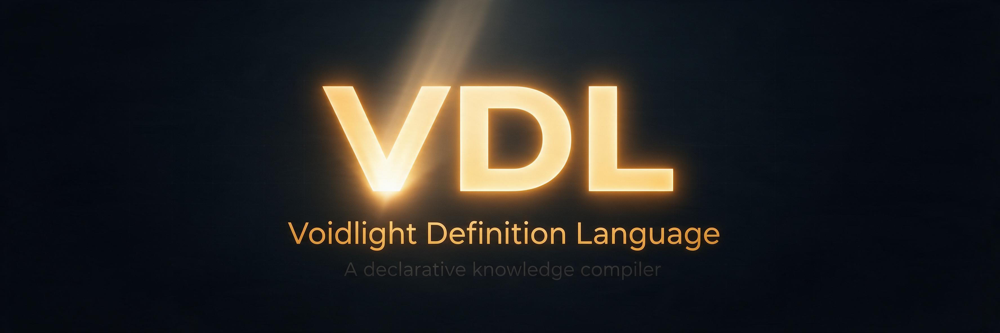

<p align="center">
  
</p>

<h1 align="center">VDL Compiler</h1>

<p align="center">
  <a href="LICENSE"></a>
  
  
  
</p>

> **Voidlight Definition Language** — a standalone Rust compiler that turns
> declarative knowledge definitions into composed Markdown, JSON Graph,
> Search Index, and Graphviz DOT output.

VDL is a domain-specific language for describing, structuring, and
interconnecting knowledge systems. Its core idea: **the source defines its
own model.** A VDL document declares its own entity types, fields, and
composition rules in a `schema` block — the compiler learns the model from
the source, not the other way around.

## Quick Start

```bash
# 1. Install
git clone https://github.com/voidlight-labs/vdl
cd vdl
cargo install --path .

# 2. Validate a VDL file
vdl validate tests/fixtures/seven_laws.vdl

# 3. Compile a legacy document to all output formats
vdl compile tests/fixtures/seven_laws.vdl
# Output appears in ./output/

# 4. Build a schema project using vdl.toml
vdl compile tests/fixtures/project
# Markdown targets appear under the project's dist/ directory
```

Requires the [Rust](https://rustup.rs/) toolchain (edition 2021+). More
installation options: see below.

## A 30-second taste

```vdl
schema "runbooks" {
    type "Runbook" {
        field "label" text heading
        field "chapters" ref "Chapter" compose
    }

    type "Chapter" {
        field "label" text heading
        field "content" body
    }
}

Chapter "intro" {
    label "Introduction"
    content "Prose starts here."
}

Runbook "core-guide" {
    label "Core Guide"
    chapters ["intro"]
}
```

```bash
vdl compose . --root core-guide
# → Markdown document with frontmatter, composed headings, and the
#   chapter's body inline.
```

## Pipeline status

| Capability | Status |
|------------|--------|
| Lexer / parser / validator / graph / codegen | ✅ shipped |
| Schema documents (author-defined model, single file + project) | ✅ shipped |
| Multi-file projects with `vdl.toml` manifests + build safety | ✅ shipped |
| Composition: `compose`, `include`, `inline`, heading numbering | ✅ shipped |
| Cite rendering: `cite` modifier, `--cites none\|link\|short`, per-target manifest key | ✅ shipped |
| Heading-aware labels (`#### LABEL`) + inline metadata fields | ✅ shipped |
| Co-occurrence validation (require-if-verified guards for dalil files) | ⏳ postponed (alternative: lint script) |
| Multi-domain handoff (music) | 📋 proposed |

`cargo test --lib` currently reports **203 passed** (2 ignored). Known
environment quirk: 3 `project_test` integration tests fail on some Windows
setups due to `miette` stderr line-wrapping — not a regression.

## Documentation

| Document | Contents |
|----------|----------|
| [docs/grammar.md](docs/grammar.md) | Grammar reference: schema form (primary) + legacy form appendix |
| [docs/schema-projects.md](docs/schema-projects.md) | Multi-file projects, `vdl.toml` manifests, project diagnostics |
| [docs/composition.md](docs/composition.md) | Compose output, labels, heading numbering, cite rendering, build safety |
| [docs/validation.md](docs/validation.md) | Validation rules V1–V16, legacy checks, project diagnostics |
| [docs/cli.md](docs/cli.md) | Every command and its flags |
| [docs/architecture.md](docs/architecture.md) | Compiler stages, project layout, dependencies |

## Installation

### Option 1: Install globally with `cargo install` (recommended)

```bash
git clone https://github.com/voidlight-labs/vdl
cd vdl
cargo install --path .
vdl --help
```

> Make sure `~/.cargo/bin` is in your `PATH`. If you installed Rust via
> `rustup`, this is usually already configured.

### Option 2: Run without installing

```bash
cargo build --release
./target/release/vdl --help
```

### Option 3: Copy the binary to a system directory

```bash
cargo build --release
sudo cp target/release/vdl /usr/local/bin/
vdl --help
```

## Testing

```bash
cargo test              # all tests including snapshot tests
cargo test --lib        # unit tests only
cargo insta review      # update snapshots (if output format changes)
```

## Zed syntax highlighting

Syntax highlighting for VDL, including embedded Markdown, is available
through the [local VDL extension](editors/zed/README.md).

## License

MIT — see [LICENSE](LICENSE).

## Acknowledgments

Built for the **Voidlight** knowledge operating system. The Seven Laws and
Divine Alignment framework are original works by Khayren.
